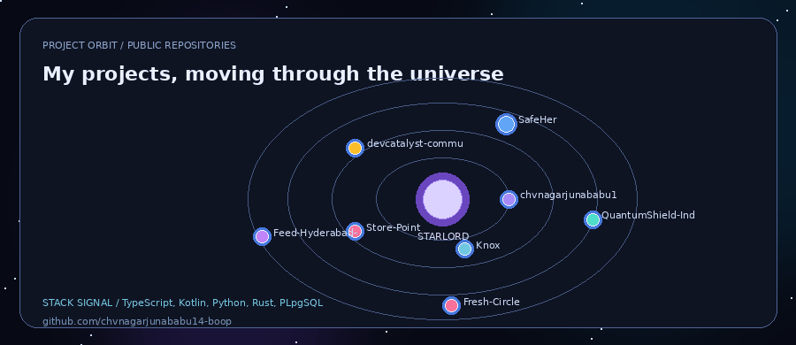

### ✦ StarLord · Developer / Builder / Explorer

Turning ideas into experiments, experiments into projects.

[ **PROJECTS** ](https://github.com/chvnagarjunababu14-boop?tab=repositories) &nbsp; · &nbsp; [ **PROFILE** ](https://github.com/chvnagarjunababu14-boop)

---

## ◈ SIGNALS

<table><tr><td align="center"><strong>8</strong> PUBLIC REPOSITORIES</td><td align="center"><strong>★ 3</strong> STARS</td><td align="center"><strong>8</strong> LANGUAGES</td><td align="center"><strong>2</strong> FOLLOWERS</td></tr></table>

## ◈ PROJECT TRANSMISSIONS

<table>
<tr><td width="50%" valign="top"><a href="https://github.com/chvnagarjunababu14-boop/SafeHer"><strong>01 / SafeHer</strong></a> SafeHer — a privacy-first Android personal safety app built with Kotlin and Jetpack Compose. ⌁ Kotlin &nbsp; ★ 3</td><td width="50%" valign="top"><a href="https://github.com/chvnagarjunababu14-boop/chvnagarjunababu14-boop"><strong>02 / chvnagarjunababu14-boop</strong></a> A public project in my build universe. ⌁ Python &nbsp; ★ 0</td></tr><tr><td width="50%" valign="top"><a href="https://github.com/chvnagarjunababu14-boop/Knox"><strong>03 / Knox</strong></a> A public project in my build universe. ⌁ TypeScript &nbsp; ★ 0</td><td width="50%" valign="top"><a href="https://github.com/chvnagarjunababu14-boop/Store-Point"><strong>04 / Store-Point</strong></a> A public project in my build universe. ⌁ TypeScript &nbsp; ★ 0</td></tr><tr><td width="50%" valign="top"><a href="https://github.com/chvnagarjunababu14-boop/devcatalyst-community-crm"><strong>05 / devcatalyst-community-crm</strong></a>  Community Registration and CRM platform built for the DevCatalyst OSS recruitment task ⌁ TypeScript &nbsp; ★ 0</td><td width="50%" valign="top"><a href="https://github.com/chvnagarjunababu14-boop/QuantumShield-India"><strong>06 / QuantumShield-India</strong></a> A public project in my build universe. ⌁ TypeScript &nbsp; ★ 0</td></tr>
</table>

<a href="https://github.com/chvnagarjunababu14-boop?tab=repositories">VIEW ALL PROJECTS ↗</a>

## ◈ TOOLKIT / LANGUAGES

 58% &nbsp;  22% &nbsp;  9% &nbsp;  8% &nbsp;  1% &nbsp;  1% &nbsp;  1% &nbsp;  0%

## ◈ GITHUB TELEMETRY

---

✦ Data from public repositories · Generated automatically · Stay curious, keep building.

