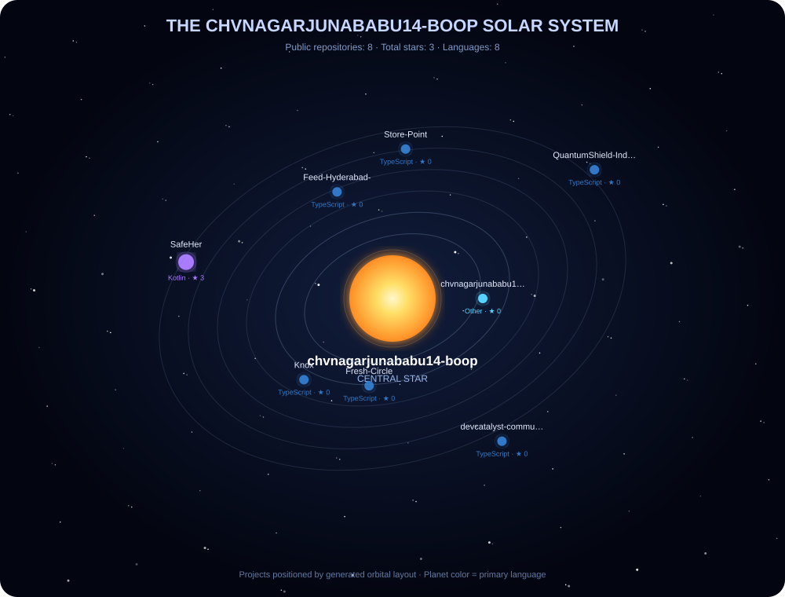

<!-- SOLAR SYSTEM PROFILE: AUTO-GENERATED -->

  <h1>🌌 StarLord's GitHub Universe</h1>
  
<i>Every project is a world. Every language, a constellation.</i>

  

## 🪐 My Projects Orbit
This solar system is generated from my **public GitHub repositories**. Projects, detected languages, stars, and activity are refreshed automatically.

<!-- PROJECTS:START -->
- [chvnagarjunababu14-boop](https://github.com/chvnagarjunababu14-boop/chvnagarjunababu14-boop) — Public project · Mixed · ⭐ 0
- [Knox](https://github.com/chvnagarjunababu14-boop/Knox) — Public project · TypeScript · ⭐ 0
- [Store-Point](https://github.com/chvnagarjunababu14-boop/Store-Point) — Public project · TypeScript · ⭐ 0
- [devcatalyst-community-crm](https://github.com/chvnagarjunababu14-boop/devcatalyst-community-crm) —  Community Registration and CRM platform built for the DevCatalyst OSS recruitment task · TypeScript · ⭐ 0
- [SafeHer](https://github.com/chvnagarjunababu14-boop/SafeHer) — SafeHer — a privacy-first Android personal safety app built with Kotlin and Jetpack Compose. · Kotlin · ⭐ 3
- [QuantumShield-India](https://github.com/chvnagarjunababu14-boop/QuantumShield-India) — Public project · TypeScript · ⭐ 0
- [Fresh-Circle](https://github.com/chvnagarjunababu14-boop/Fresh-Circle) — Public project · TypeScript · ⭐ 0
- [Feed-Hyderabad-](https://github.com/chvnagarjunababu14-boop/Feed-Hyderabad-) — Public project · TypeScript · ⭐ 0
<!-- PROJECTS:END -->

## 🧰 Detected Stack
<!-- STACK:START -->
**TypeScript** · **Kotlin** · **Python** · **Rust** · **PLpgSQL** · **JavaScript** · **CSS** · **Java**
<!-- STACK:END -->

## 🔄 System Updates
- Runs automatically every day
- Also supports manual refresh from the Actions tab
- Only public repositories are included

  <a href="https://github.com/chvnagarjunababu14-boop">GitHub Profile</a> · <a href="https://github.com/chvnagarjunababu14-boop?tab=repositories">Explore Repositories</a>

