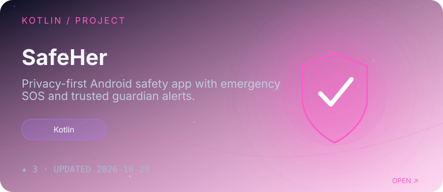
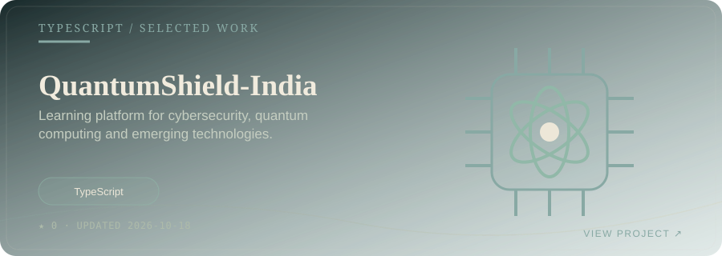

<table width="100%" cellpadding="20" cellspacing="0" bgcolor="#18251F">
<tr><td>

01 / THE PERSON BEHIND THE PROJECTS

<h2>A Little About Me</h2>

Hey, I'm <b>Venkata Nagarjuna Babu Chitturi</b> — a student, developer, builder and curious mind who loves turning ideas into real-world projects.

I'm passionate about exploring different areas of software development, from crafting polished interfaces and Android applications to building backend systems, developer tools and experimenting with emerging technologies.

I love attending tech events, meeting fellow builders, exploring new ideas and, most importantly, building things that genuinely excite me. For me, every project is an opportunity to learn something new, challenge myself and turn curiosity into creation.

<h3>What I Enjoy Building</h3>
<table width="100%" cellpadding="8" cellspacing="0">
<tr>
<td width="50%" valign="top">

📱 <b>Mobile Applications</b> Android apps and practical everyday solutions.

🌐 <b>Web Experiences</b> Modern interfaces, full-stack applications and useful platforms.

⚙️ <b>Developer Tools</b> Desktop software, automation and productivity tools.

</td>
<td width="50%" valign="top">

🔐 <b>Emerging Technology</b> Cybersecurity, quantum computing and AI-powered ideas.

🤝 <b>Community Projects</b> Tools that connect people and make collaboration easier.

</td>
</tr>
</table>
<h3>My Approach</h3>

I believe in learning by building, experimenting beyond my comfort zone, embracing challenges and improving every project one iteration at a time.

<i>I'm always curious about what's next, always exploring, and always looking for something exciting to build.</i>

<b>Build thoughtfully. Experiment boldly. Keep learning.</b>

</td></tr>
</table>

<h2 align="center">✦ &nbsp; SELECTED WORK</h2>
7 public projects · spanning mobile, developer tools, security and community.

 &nbsp; 

 &nbsp; 

 &nbsp; 

<a href="https://github.com/chvnagarjunababu14-boop?tab=repositories"><b>Explore all repositories ↗</b></a>

An evolving collection of public work · Updated automatically · Private repositories are excluded

<a href="https://github.com/chvnagarjunababu14-boop">GitHub profile ↗</a>

