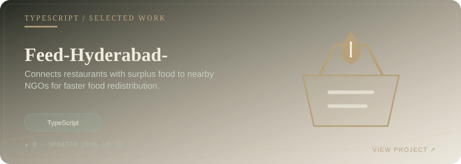

<h2 align="center">✦ &nbsp; SELECTED WORK</h2>
7 public projects · spanning mobile, developer tools, security and community.

 &nbsp; 

 &nbsp; 

 &nbsp; 

<a href="https://github.com/chvnagarjunababu14-boop?tab=repositories"><b>Explore all repositories ↗</b></a>

An evolving collection of public work · Updated automatically · Private repositories are excluded

<a href="https://github.com/chvnagarjunababu14-boop">GitHub profile ↗</a>

