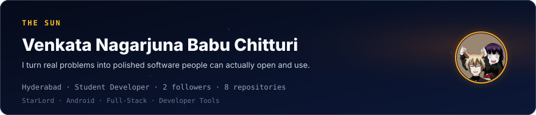
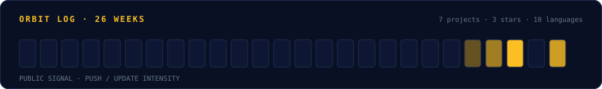

<!-- SOLAR SYSTEM ORBITS HERO -->

 
<i>I am the sun; my languages are the planets and my projects their moons.</i>
  

<!-- THE SUN (ABOUT CARD) -->

---

## 🌕 The Moons — Featured Repositories

<table border="0" width="100%">
<tr>
<td width="50%" valign="top"></td>
<td width="50%" valign="top"></td>
</tr>
<tr>
<td width="50%" valign="top"></td>
<td width="50%" valign="top"></td>
</tr>
</table>

Also in orbit: <a href="https://github.com/chvnagarjunababu14-boop/QuantumShield-India">QuantumShield India</a> · <a href="https://github.com/chvnagarjunababu14-boop/Fresh-Circle">FreshLink</a> · <a href="https://github.com/chvnagarjunababu14-boop/Feed-Hyderabad-">Feed Hyderabad</a>

4 featured · 7 public projects · Android, tools, security and community.

---

## 🪐 The Planets — Planetary System & Tech Stack

<b>Orbital Distance & Evidence Index</b>

 

| Orbit | Celestial Body | Domain | Verified Repositories |
|---|---|---|---|
| **Orbit 1** | **TypeScript** (Inner) | Web Architecture &amp; Full-Stack Products | [`Knox`](https://github.com/chvnagarjunababu14-boop/Knox), [`StorePoint`](https://github.com/chvnagarjunababu14-boop/Store-Point) |
| **Orbit 2** | **Kotlin** (Orbit 2) | Android &amp; Privacy-Minded Mobile | [`SafeHer-Next`](https://github.com/chvnagarjunababu14-boop/SafeHer) |
| **Orbit 3** | **Python** (Orbit 3) | Learning Systems &amp; Experiments | _exploring_ |
| **Orbit 4** | **Rust** (Orbit 4) | Developer Tools &amp; Agent Memory | _exploring_ |
| **Orbit 5** | **PLpgSQL** (Outer) | Data Layer &amp; Persistence | _exploring_ |

---

## 📡 Solar Log — Revolutions & Telemetry

### Verified Experience & Orbit Logs
- **Student Developer** — *Hyderabad* `[Building in public]`
  - Shipping Android apps, full-stack products, and developer tools people can actually use.
- **Focus Systems** — *SafeHer · Knox · StorePoint · DevCatalyst*
  - Privacy-minded mobile, agent memory, retail POS, and campus community CRM.
- **Exploration Orbits** — *QuantumShield · FreshLink · Feed Hyderabad*
  - Security/quantum learning, produce markets, and surplus-food logistics.

### Signals & Credentials
- ★ **SafeHer-Next** — privacy-first Android safety app with SOS + guardian alerts
- 🛰 **Knox** — Rust knowledge graph preserving decisions for AI coding agents
- 🛰 **StorePoint** — offline-first retail POS with inventory and branch analytics
- 📍 Based in **Hyderabad** · open to collaboration with fellow builders

---

## ☀️ Transmission Channels

  

  <a href="https://github.com/chvnagarjunababu14-boop">GitHub</a> ·
  <a href="mailto:chvnagarjunababu14@gmail.com">Email</a> ·
  <a href="https://github.com/chvnagarjunababu14-boop?tab=repositories">All repositories</a>

Solar System · planets are languages, moons are projects, comets are recent pushes · automatically refreshed

