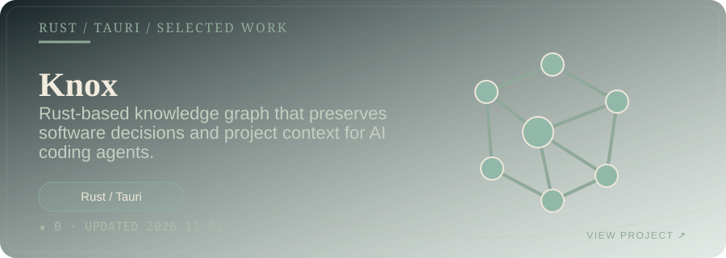

<h2 align="center">✦ &nbsp; SELECTED PROJECTS</h2>
7 public projects · updated automatically from GitHub

<table width="100%" cellspacing="12" cellpadding="0">

 &nbsp; 
\n
 &nbsp; 
\n
 &nbsp; 
\n

</table>

<a href="https://github.com/chvnagarjunababu14-boop?tab=repositories"><b>Explore all repositories ↗</b></a>

<h2 align="center">📊 &nbsp; GITHUB ANALYTICS</h2>

 

✨ Auto-generated from public GitHub data · Private repositories excluded

