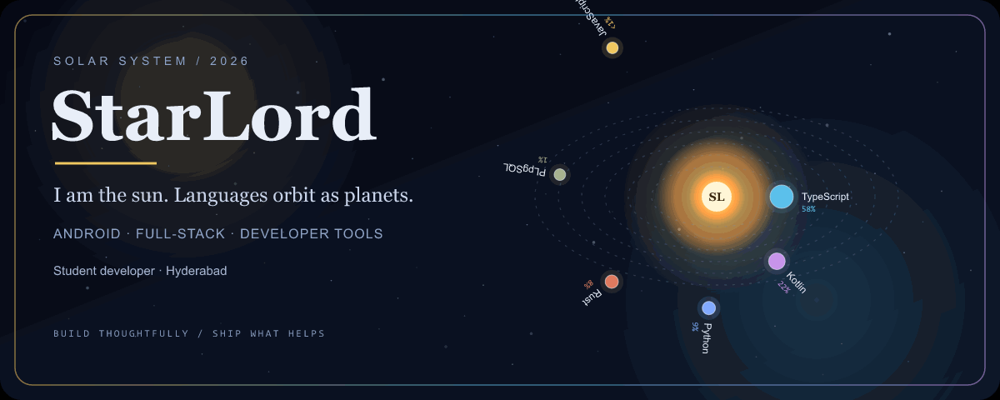
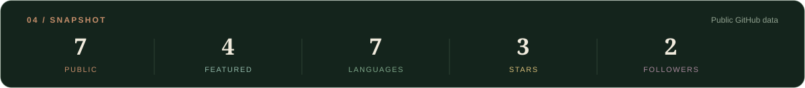
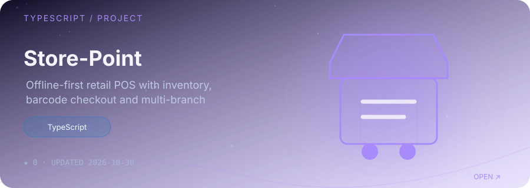

 &nbsp;  &nbsp;  &nbsp; 

Hey, I’m <strong>Venkata Nagarjuna Babu Chitturi</strong> — known online as <strong>StarLord</strong>. I’m a student developer focused on turning real problems into polished, usable software.

I spend most of my time on <strong>Android apps</strong>, <strong>full-stack web products</strong>, and <strong>developer tools</strong>. On the side I explore security, AI, and community platforms — always with a bias toward shipping something people can actually open and use.

<h3>Where I Focus</h3>

<strong>Android</strong> — privacy-minded mobile tools with clear UX. 
<strong>Full-stack web</strong> — practical products for retail, food systems, and student communities. 
<strong>Developer tools</strong> — workflows and agents that keep context while you build.

<h3>How I Work</h3>

I learn by building in public: start with a sharp problem, ship an early version, then refine. Curious collaborators and hard feedback welcome.

4 featured · 7 public projects · Android, tools, security and community.

 &nbsp; 

 &nbsp; 

Also in orbit: <a href="https://github.com/chvnagarjunababu14-boop/QuantumShield-India">QuantumShield India</a> · <a href="https://github.com/chvnagarjunababu14-boop/Fresh-Circle">FreshLink</a> · <a href="https://github.com/chvnagarjunababu14-boop/Feed-Hyderabad-">Feed Hyderabad</a>

A living solar system of public work · Automatically refreshed · Private repositories stay private

