### ✦ Developer · Builder · Curious Mind

**I turn ideas into projects and keep learning by building.**

 

---

## ◈ About

A curious developer who enjoys building projects, exploring technologies and learning by doing.

<table><tr><td><strong>Repositories</strong> 8 public projects</td><td><strong>Stars</strong> ★ 3</td><td><strong>Languages</strong> 8 detected</td><td><strong>Followers</strong> 2</td></tr></table>

## ◈ Featured Projects

<table>
<tr><td width="50%" valign="top"><a href="https://github.com/chvnagarjunababu14-boop/SafeHer"><strong>✦ SafeHer</strong></a> SafeHer — a privacy-first Android personal safety app built with Kotlin and Jetpack Compose. ◈ Kotlin &nbsp; ★ 3</td><td width="50%" valign="top"><a href="https://github.com/chvnagarjunababu14-boop/chvnagarjunababu14-boop"><strong>✦ chvnagarjunababu14-boop</strong></a> Project repository ◈ Python &nbsp; ★ 0</td></tr><tr><td width="50%" valign="top"><a href="https://github.com/chvnagarjunababu14-boop/Knox"><strong>✦ Knox</strong></a> Project repository ◈ TypeScript &nbsp; ★ 0</td><td width="50%" valign="top"><a href="https://github.com/chvnagarjunababu14-boop/Store-Point"><strong>✦ Store-Point</strong></a> Project repository ◈ TypeScript &nbsp; ★ 0</td></tr><tr><td width="50%" valign="top"><a href="https://github.com/chvnagarjunababu14-boop/devcatalyst-community-crm"><strong>✦ devcatalyst-community-crm</strong></a>  Community Registration and CRM platform built for the DevCatalyst OSS recruitment task ◈ TypeScript &nbsp; ★ 0</td><td width="50%" valign="top"><a href="https://github.com/chvnagarjunababu14-boop/QuantumShield-India"><strong>✦ QuantumShield-India</strong></a> Project repository ◈ TypeScript &nbsp; ★ 0</td></tr>
</table>

## ◈ Technology Stack

       

## ◈ GitHub Analytics

✨ Public profile data refreshes automatically via GitHub Actions · Glass-inspired design

