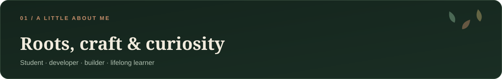
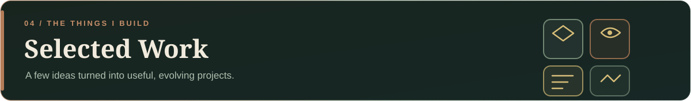

   

 &nbsp; 

 &nbsp; 

Also growing: <a href="https://github.com/chvnagarjunababu14-boop/QuantumShield-India">QuantumShield India</a> · <a href="https://github.com/chvnagarjunababu14-boop/Fresh-Circle">FreshLink</a> · <a href="https://github.com/chvnagarjunababu14-boop/Feed-Hyderabad-">Feed Hyderabad</a>

4 featured · 7 public projects · Android, tools, security and community.

A living grove of public work · Automatically refreshed · Private repositories stay private

