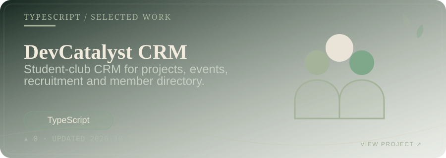

<table width="100%" cellspacing="8" cellpadding="12"><tr><td align="center" bgcolor="#17132e"><h2>🌌 8</h2>PUBLIC REPOSITORIES</td><td align="center" bgcolor="#111b34"><h2>⭐ 3</h2>TOTAL STARS</td><td align="center" bgcolor="#12243a"><h2>🧬 8</h2>LANGUAGES</td><td align="center" bgcolor="#201331"><h2>👥 2</h2>FOLLOWERS</td></tr></table>

<h2>🧰 &nbsp; TECH STACK</h2>
 58% &nbsp;  22% &nbsp;  9% &nbsp;  8% &nbsp;  1% &nbsp;  1% &nbsp;  1% &nbsp;  <1%

<h2>🚀 &nbsp; FEATURED PROJECTS</h2>
Selected from public repositories · dynamically refreshed

<table width="100%" cellspacing="12" cellpadding="0">
<tr><td width="50%" valign="top"></td><td width="50%" valign="top"></td></tr><tr><td width="50%" valign="top"></td><td width="50%" valign="top"></td></tr><tr><td width="50%" valign="top"></td><td width="50%" valign="top"></td></tr><tr><td width="50%" valign="top"></td><td width="50%"></td></tr>
</table>

<a href="https://github.com/chvnagarjunababu14-boop?tab=repositories"><b>Explore all repositories ↗</b></a>

<h2 align="center">📊 &nbsp; GITHUB ANALYTICS</h2>

 

✨ Auto-generated from public GitHub data · Private repositories excluded

