<h1>✦ StarLord</h1>

<b>Developer · Builder · Explorer</b>

Turning curiosity into code—and ideas into things that work.

<a href="https://github.com/chvnagarjunababu14-boop?tab=repositories">⌁ Explore projects</a> &nbsp; · &nbsp; <a href="https://github.com/chvnagarjunababu14-boop">⌁ GitHub profile</a>

<table><tr><td align="center" bgcolor="#211631"><h2>✦ 8</h2>PUBLIC PROJECTS</td><td align="center" bgcolor="#10283b"><h2>★ 3</h2>STARS EARNED</td><td align="center" bgcolor="#18263b"><h2>⌁ 8</h2>LANGUAGES</td><td align="center" bgcolor="#2a1b2e"><h2>◉ 2</h2>FOLLOWERS</td></tr></table>

---

<h2>🚀 &nbsp; Featured builds</h2>
Selected from public repositories · ranked by stars and recent activity

<table width="100%">
<tr><td width="50%" valign="top" bgcolor="#201831"><table width="100%" cellpadding="10"><tr><td bgcolor="#A97BFF"><b>✦ BUILD / 01</b></td><td align="right" bgcolor="#201831">● ONLINE</td></tr></table><table width="100%" cellpadding="10"><tr><td><h3><a href="https://github.com/chvnagarjunababu14-boop/SafeHer">↗ SafeHer</a></h3>
SafeHer — a privacy-first Android personal safety app built with Kotlin and Jetpack Compose.
  <table><tr><td bgcolor="#0b1220">★ <b>3</b> STARS</td><td bgcolor="#0b1220">◷ UPDATED 2026-10-29</td></tr></table> <a href="https://github.com/chvnagarjunababu14-boop/SafeHer"><b>EXPLORE BUILD &nbsp; ↗</b></a></td></tr></table><table width="100%"><tr><td bgcolor="#A97BFF">.</td></tr></table></td><td width="50%" valign="top" bgcolor="#122739"><table width="100%" cellpadding="10"><tr><td bgcolor="#3572A5"><b>✦ BUILD / 02</b></td><td align="right" bgcolor="#122739">● ONLINE</td></tr></table><table width="100%" cellpadding="10"><tr><td><h3><a href="https://github.com/chvnagarjunababu14-boop/chvnagarjunababu14-boop">↗ chvnagarjunababu14-boop</a></h3>
A Python project from my build universe.
  <table><tr><td bgcolor="#0b1220">★ <b>0</b> STARS</td><td bgcolor="#0b1220">◷ UPDATED 2026-11-19</td></tr></table> <a href="https://github.com/chvnagarjunababu14-boop/chvnagarjunababu14-boop"><b>EXPLORE BUILD &nbsp; ↗</b></a></td></tr></table><table width="100%"><tr><td bgcolor="#3572A5">.</td></tr></table></td></tr><tr><td width="50%" valign="top" bgcolor="#111d33"><table width="100%" cellpadding="10"><tr><td bgcolor="#3178c6"><b>✦ BUILD / 03</b></td><td align="right" bgcolor="#111d33">● ONLINE</td></tr></table><table width="100%" cellpadding="10"><tr><td><h3><a href="https://github.com/chvnagarjunababu14-boop/Knox">↗ Knox</a></h3>
A TypeScript project from my build universe.
  <table><tr><td bgcolor="#0b1220">★ <b>0</b> STARS</td><td bgcolor="#0b1220">◷ UPDATED 2026-11-01</td></tr></table> <a href="https://github.com/chvnagarjunababu14-boop/Knox"><b>EXPLORE BUILD &nbsp; ↗</b></a></td></tr></table><table width="100%"><tr><td bgcolor="#3178c6">.</td></tr></table></td><td width="50%" valign="top" bgcolor="#111d33"><table width="100%" cellpadding="10"><tr><td bgcolor="#3178c6"><b>✦ BUILD / 04</b></td><td align="right" bgcolor="#111d33">● ONLINE</td></tr></table><table width="100%" cellpadding="10"><tr><td><h3><a href="https://github.com/chvnagarjunababu14-boop/Store-Point">↗ Store-Point</a></h3>
A TypeScript project from my build universe.
  <table><tr><td bgcolor="#0b1220">★ <b>0</b> STARS</td><td bgcolor="#0b1220">◷ UPDATED 2026-10-30</td></tr></table> <a href="https://github.com/chvnagarjunababu14-boop/Store-Point"><b>EXPLORE BUILD &nbsp; ↗</b></a></td></tr></table><table width="100%"><tr><td bgcolor="#3178c6">.</td></tr></table></td></tr><tr><td width="50%" valign="top" bgcolor="#111d33"><table width="100%" cellpadding="10"><tr><td bgcolor="#3178c6"><b>✦ BUILD / 05</b></td><td align="right" bgcolor="#111d33">● ONLINE</td></tr></table><table width="100%" cellpadding="10"><tr><td><h3><a href="https://github.com/chvnagarjunababu14-boop/devcatalyst-community-crm">↗ devcatalyst-community-crm</a></h3>
 Community Registration and CRM platform built for the DevCatalyst OSS recruitment task
  <table><tr><td bgcolor="#0b1220">★ <b>0</b> STARS</td><td bgcolor="#0b1220">◷ UPDATED 2026-10-29</td></tr></table> <a href="https://github.com/chvnagarjunababu14-boop/devcatalyst-community-crm"><b>EXPLORE BUILD &nbsp; ↗</b></a></td></tr></table><table width="100%"><tr><td bgcolor="#3178c6">.</td></tr></table></td><td width="50%" valign="top" bgcolor="#111d33"><table width="100%" cellpadding="10"><tr><td bgcolor="#3178c6"><b>✦ BUILD / 06</b></td><td align="right" bgcolor="#111d33">● ONLINE</td></tr></table><table width="100%" cellpadding="10"><tr><td><h3><a href="https://github.com/chvnagarjunababu14-boop/QuantumShield-India">↗ QuantumShield-India</a></h3>
A TypeScript project from my build universe.
  <table><tr><td bgcolor="#0b1220">★ <b>0</b> STARS</td><td bgcolor="#0b1220">◷ UPDATED 2026-10-18</td></tr></table> <a href="https://github.com/chvnagarjunababu14-boop/QuantumShield-India"><b>EXPLORE BUILD &nbsp; ↗</b></a></td></tr></table><table width="100%"><tr><td bgcolor="#3178c6">.</td></tr></table></td></tr>
</table>

<a href="https://github.com/chvnagarjunababu14-boop?tab=repositories"><b>Explore all repositories ↗</b></a>

---

<h2>🧬 &nbsp; Languages in my orbit</h2>

 58% &nbsp;  22% &nbsp;  9% &nbsp;  8% &nbsp;  1% &nbsp;  1% &nbsp;  1% &nbsp;  0%

---

<h2>📡 &nbsp; GitHub telemetry</h2>

✦ Automatically refreshed from public GitHub data · Built with curiosity
