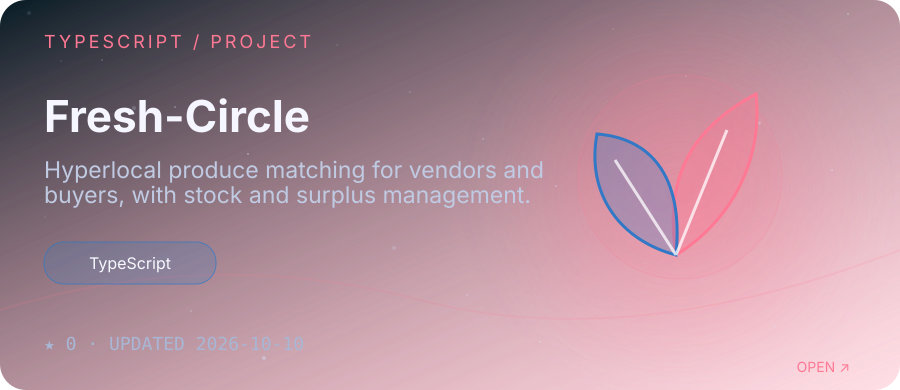

Hey, I’m <strong>Venkata Nagarjuna Babu Chitturi</strong> — a student, developer and builder who enjoys turning curiosity into things people can actually use.

My work moves between polished web experiences and Android apps, backend systems, developer tools, and experiments in cybersecurity, quantum technology and AI. I also enjoy tech events, meeting fellow builders and learning through collaboration.

<h3>What I Enjoy Building</h3>
<table width="100%" cellpadding="13" cellspacing="0">
<tr>
<td width="50%" valign="top">
<strong>📱 Mobile Applications</strong>

Android apps and practical tools that solve everyday problems.
</td>
<td width="50%" valign="top">
<strong>🌐 Web Experiences</strong>

Responsive interfaces, full-stack apps and useful digital platforms.
</td>
</tr>
<tr>
<td width="50%" valign="top">
<strong>⚙️ Developer Tools</strong>

Desktop software, automation and workflows that make building easier.
</td>
<td width="50%" valign="top">
<strong>🔐 Emerging Technology</strong>

Cybersecurity, quantum computing and AI-powered experiments.
</td>
</tr>
<tr>
<td colspan="2" align="center">
<strong>🤝 Community Projects</strong>

Tools that bring people together and make collaboration easier.
</td>
</tr>
</table>

<h3>My Approach</h3>

I learn best by building: trying ideas, stepping outside my comfort zone, and improving with every iteration. I’m always exploring what’s next — and looking for the next idea worth bringing to life.

<h2 align="center">✦ &nbsp; SELECTED WORK</h2>
7 public projects · spanning mobile, developer tools, security and community.

 &nbsp; 

 &nbsp; 

 &nbsp; 

<a href="https://github.com/chvnagarjunababu14-boop?tab=repositories"><b>Explore all repositories ↗</b></a>

An evolving collection of public work · Updated automatically · Private repositories are excluded

<a href="https://github.com/chvnagarjunababu14-boop">GitHub profile ↗</a>

